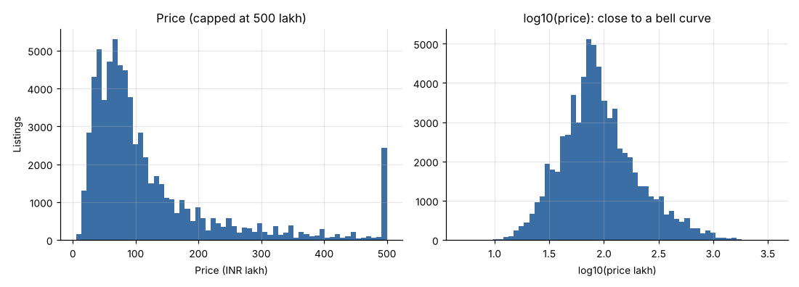
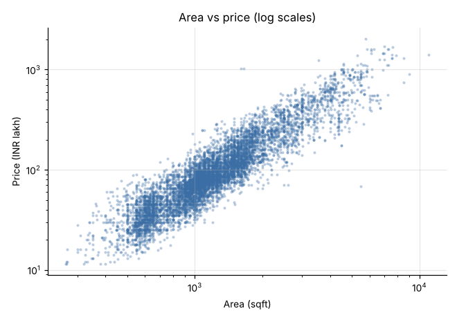
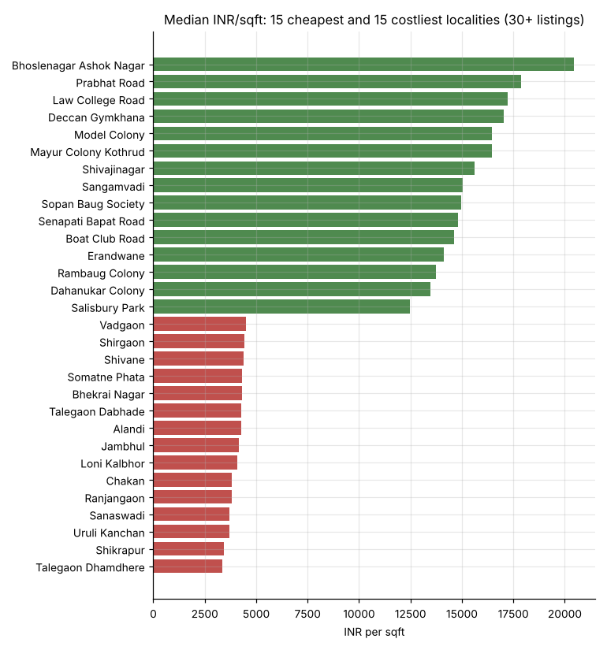
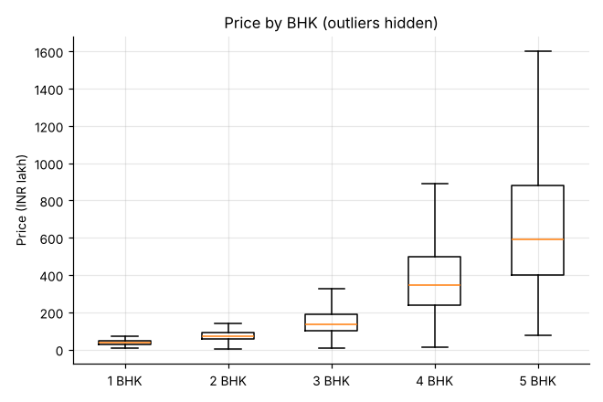
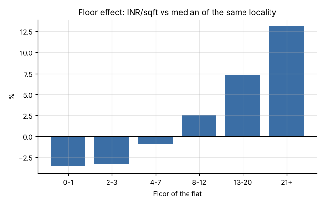
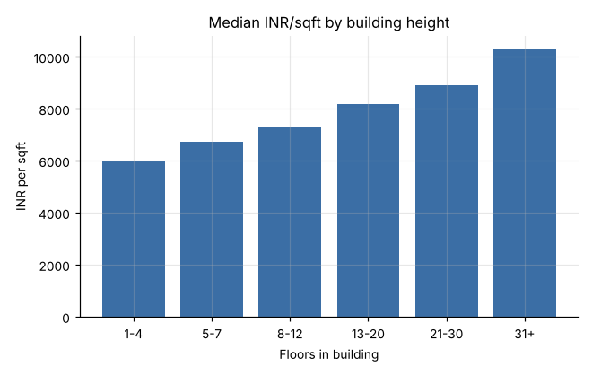
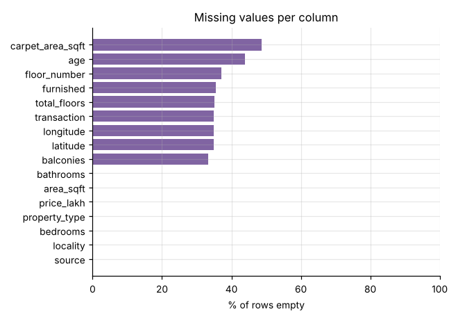
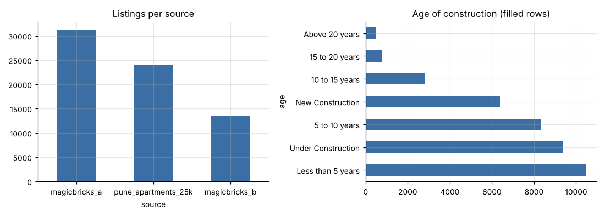

# Step 2: data exploration

Rows: 68,978  ·  localities: 1,346

## Findings
1. Price is right-skewed (skew 4.15); log(price) is nearly symmetric (skew 0.51). -> the model will predict log(price).
2. Area and price are strongly related on log scales (correlation 0.91).
3. Locality matters: Kruskal-Wallis p = 0.0e+00 across 196 localities. Cheapest Talegaon Dhamdhere 3,364 vs costliest Bhoslenagar Ashok Nagar 20,460 INR/sqft.
4. Median price by BHK: 1 BHK 35 lakh, 2 BHK 72 lakh, 3 BHK 135 lakh, 4 BHK 345 lakh, 5 BHK 589 lakh.
5. Floor effect vs same locality: floor 0-1: -3.5%, floor 2-3: -3.2%, floor 4-7: -0.9%, floor 8-12: +2.6%, floor 13-20: +7.3%, floor 21+: +13.1%.
6. Missing values: bathrooms 0.1%, balconies 33.2%, latitude 35.0%, longitude 35.0%, transaction 35.0%, total_floors 35.2%, furnished 35.5%, floor_number 37.0%, age 44.0%, carpet_area_sqft 48.7%.

## Problems for step 3 (cleaning)
- area below 250 sqft: 81
- area above 10000 sqft: 8
- price below 5 lakh: 6
- price above 2000 lakh: 6
- rate below 2000 or above 40000 per sqft: 87
- bathrooms more than bedrooms plus 2: 9
- coordinates outside pune: 308
- localities with under 10 listings: 945
- possible duplicate locality names: kalyani nagar / new kalyani nagar; hinjawadi / hinjewadi; manjri / manjari; phase 3 hinjewadi rajiv gandhi infotech park / phase 1 hinjewadi rajiv gandhi infotech park; phase 3 hinjewadi rajiv gandhi infotech park / phase 2 hinjewadi rajiv gandhi infotech park; phase 3 hinjewadi rajiv gandhi infotech park / hinjewadi rajiv gandhi infotech park; phase 1 hinjewadi rajiv gandhi infotech park / phase 2 hinjewadi rajiv gandhi infotech park; phase 1 hinjewadi rajiv gandhi infotech park / hinjewadi rajiv gandhi infotech park; karvenagar / karve nagar; phase 2 hinjewadi rajiv gandhi infotech park / hinjewadi rajiv gandhi infotech park; vadgaon bk / wadgaon bk

## Charts

