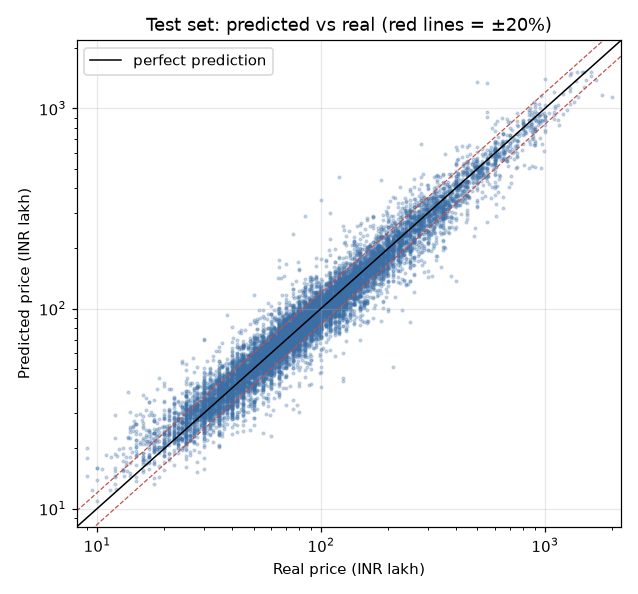
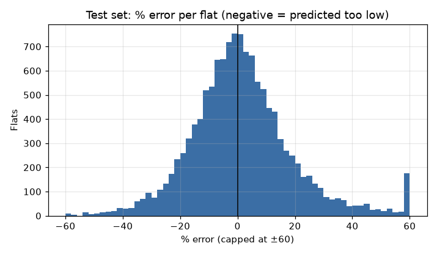
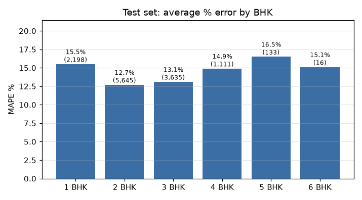
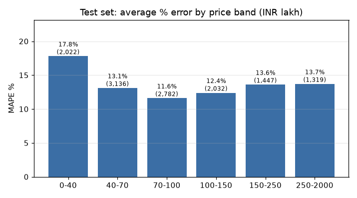

# Step 8: final evaluation on the test set

Trained on 50,949 flats; evaluated on 12,738 separate rows in the existing random holdout. Grouped cross-validation is the stricter check for similar listings.

## All models on the test set
| Model | MAE (lakh) | RMSE (lakh) | MAPE (%) | Median APE (%) | R2 | Within 10% (%) | Within 20% (%) |
|---|---|---|---|---|---|---|---|
| Baseline (similar-listing rate x area) | 23.09 | 47.99 | 18.38 | 13.76 | 0.89 | 38.49 | 65.30 |
| Ridge regression | 22.44 | 47.47 | 17.23 | 13.29 | 0.89 | 39.52 | 67.92 |
| Random forest | 17.08 | 36.62 | 13.97 | 9.98 | 0.93 | 50.11 | 77.68 |
| LightGBM | 17.62 | 37.36 | 14.12 | 10.54 | 0.93 | 47.99 | 77.57 |
| LightGBM (tuned) | 16.84 | 36.38 | 13.61 | 9.96 | 0.94 | 50.12 | 78.74 |
| LightGBM + Random forest (blended) | 16.65 | 35.96 | 13.53 | 9.8 | 0.94 | 50.79 | 78.95 |

**Final model (LightGBM + Random forest (blended)): 13.53% average error, R² 0.94, 78.95% of flats within 20%** (baseline: 18.38%). Median error per flat: 7.8 lakh.

Absolute error metrics are in 2024 price units. The app applies a ×1.086 adjustment for Oct 2026; this would scale holdout MAE to about 18.08 lakh and RMSE to 39.05 lakh. MAPE is unchanged; this adjustment is not a validation against recent sale prices.

## Is it over-fitting?
| Dataset | MAE (lakh) | RMSE (lakh) | MAPE (%) |
|---|---:|---:|---:|
| Training flats (seen) | 10.76 | 22.72 | 8.55 |
| Grouped 5-fold CV (train only) | 18.35 | 38.89 | 14.48 |
| Random holdout rows | 16.65 | 35.96 | 13.53 |

CV groups listings by locality, BHK, property type and a 25 sqft area band. The training-to-validation gap is visible here; model selection uses validation, not training error. The random holdout can contain listings similar to training rows.

Typical bias: median error +0.2% (negative = predicts slightly low).

## By BHK
| bhk | Test flats | Median price (lakh) | MAPE (%) | Within 20% (%) |
|---|---|---|---|---|
| 1 BHK | 2198 | 35.0 | 15.5 | 74.0 |
| 2 BHK | 5645 | 70.9 | 12.7 | 80.7 |
| 3 BHK | 3635 | 135.0 | 13.1 | 79.8 |
| 4 BHK | 1111 | 335.0 | 14.9 | 77.6 |
| 5 BHK | 133 | 570.0 | 16.5 | 76.7 |
| 6 BHK | 16 | 607.5 | 15.1 | 81.2 |

## By price band (INR lakh)
| price_band | Test flats | Median price (lakh) | MAPE (%) | Within 20% (%) |
|---|---|---|---|---|
| 0-40 | 2022 | 31.0 | 17.8 | 69.2 |
| 40-70 | 3136 | 56.0 | 13.1 | 80.0 |
| 70-100 | 2782 | 85.0 | 11.6 | 84.5 |
| 100-150 | 2032 | 121.0 | 12.4 | 81.1 |
| 150-250 | 1447 | 188.0 | 13.6 | 77.7 |
| 250-2000 | 1319 | 375.0 | 13.7 | 77.8 |

## Localities (with 30+ test flats: 76)
### 10 most accurate
| locality_group | Test flats | Median price (lakh) | MAPE (%) | Within 20% (%) |
|---|---|---|---|---|
| Wanowrie | 49 | 96.0 | 7.8 | 100.0 |
| New Kalyani Nagar | 37 | 153.0 | 7.9 | 100.0 |
| Tathawade Pimpri Chinchwad | 108 | 92.3 | 7.9 | 96.3 |
| Hinjewadi Phase 1 | 38 | 96.7 | 8.1 | 89.5 |
| Model Colony | 39 | 275.0 | 8.1 | 89.7 |
| Kiwale | 66 | 64.7 | 8.7 | 93.9 |
| Mahalunge | 127 | 78.5 | 8.9 | 92.9 |
| Charholi Budruk | 46 | 53.5 | 9.1 | 91.3 |
| Dhanori | 152 | 68.0 | 9.4 | 88.2 |
| Wakad | 436 | 87.9 | 9.5 | 88.3 |

### 10 least accurate
| locality_group | Test flats | Median price (lakh) | MAPE (%) | Within 20% (%) |
|---|---|---|---|---|
| Chinchwad | 34 | 70.0 | 16.6 | 67.6 |
| Dhayari | 76 | 41.0 | 17.2 | 71.1 |
| Kalyani Nagar | 407 | 182.0 | 17.4 | 70.3 |
| Narhe | 81 | 31.0 | 17.6 | 67.9 |
| Bibwewadi | 41 | 99.0 | 17.7 | 68.3 |
| Katraj | 58 | 44.5 | 18.2 | 56.9 |
| Boat Club Road | 91 | 445.0 | 18.5 | 78.0 |
| Ambegaon | 62 | 45.0 | 19.2 | 77.4 |
| Sangamvadi | 41 | 451.0 | 21.5 | 65.9 |
| Bund Garden | 35 | 150.0 | 22.6 | 71.4 |

