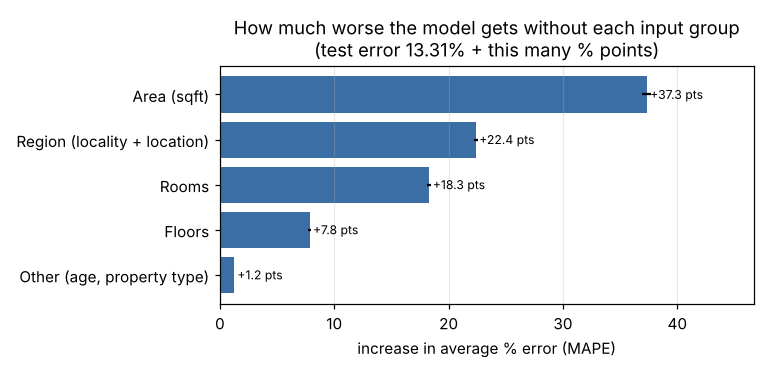
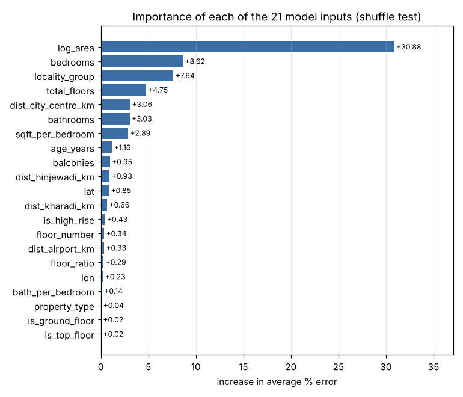
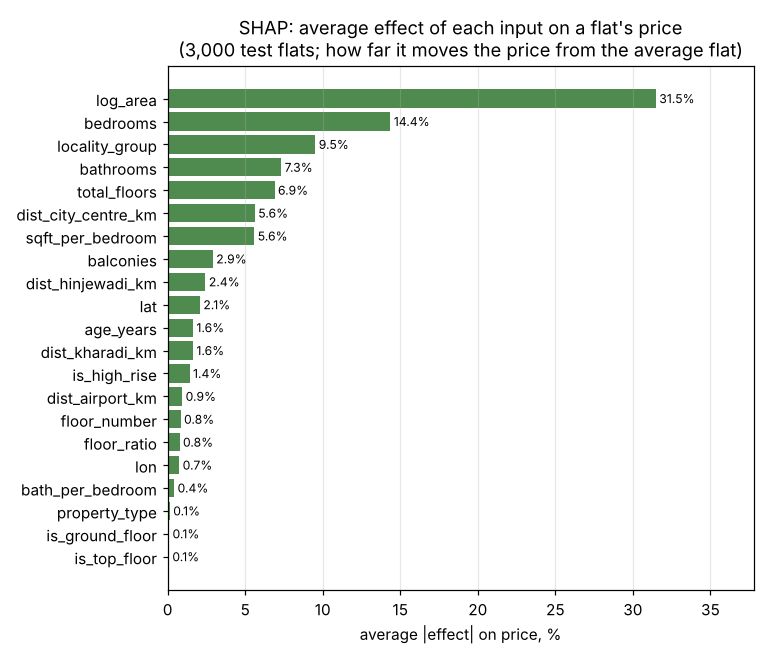
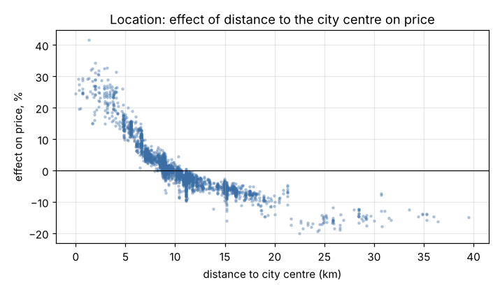
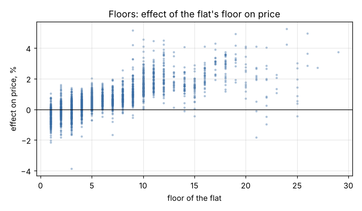
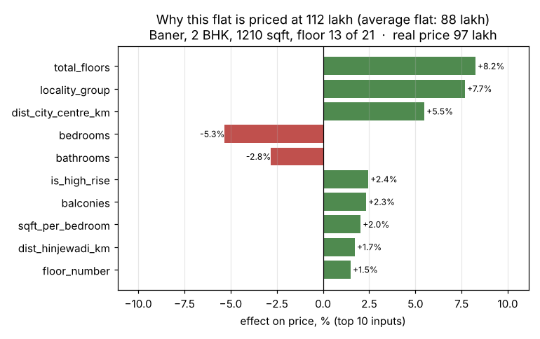

# Step 9: explaining the model

Tuned LightGBM, test error 13.31%. Importance is measured on the unseen test flats.

## 1. Which of the user's inputs matter (shuffle test, by group)
Shuffling a group's columns breaks the link between those inputs and the price; the rise in error shows how much the model depends on them.

| Input group | Error rises by (% points) | Columns |
|---|---|---|
| Area (sqft) | +37.33 (±0.41) | log_area, sqft_per_bedroom |
| Region (locality + location) | +22.38 (±0.18) | locality_group, lat, lon, dist_city_centre_km, dist_hinjewadi_km, dist_kharadi_km, dist_airport_km |
| Rooms | +18.32 (±0.18) | bedrooms, bathrooms, balconies, bath_per_bedroom |
| Floors | +7.85 (±0.15) | floor_number, total_floors, floor_ratio, is_ground_floor, is_top_floor, is_high_rise |
| Other (age, property type) | +1.23 (±0.01) | age_years, property_type |

## 2. All 21 inputs (shuffle test, one at a time)
| Input | Error rises by (% points) |
|---|---|
| log_area | +30.88 |
| bedrooms | +8.62 |
| locality_group | +7.64 |
| total_floors | +4.75 |
| dist_city_centre_km | +3.06 |
| bathrooms | +3.03 |
| sqft_per_bedroom | +2.89 |
| age_years | +1.16 |
| balconies | +0.95 |
| dist_hinjewadi_km | +0.93 |
| lat | +0.85 |
| dist_kharadi_km | +0.66 |
| is_high_rise | +0.43 |
| floor_number | +0.34 |
| dist_airport_km | +0.33 |
| floor_ratio | +0.29 |
| lon | +0.23 |
| bath_per_bedroom | +0.14 |
| property_type | +0.04 |
| is_ground_floor | +0.02 |
| is_top_floor | +0.02 |

Inputs that carry the same information (e.g. latitude and distance to the centre) share credit, so each looks smaller alone than its group does in table 1.

## 3. SHAP: average effect on a flat's price (3,000 test flats)
Starting point = the average flat, about 88 lakh. SHAP shows how far each input moves a flat's price away from it.

| Input group | Average effect |
|---|---|
| Area (sqft) | ±35.3% |
| Rooms | ±23.4% |
| Region (locality + location) | ±19.9% |
| Floors | ±9.7% |
| Other (age, property type) | ±1.7% |

## 4. Example flat
Baner, 2 BHK, 1210 sqft, floor 13 of 21: predicted **112.3 lakh** (real 97.0 lakh). Average flat 88.2 lakh, then:

| Input | Value | Effect on price |
|---|---|---|
| total_floors | 21.0 | +8.2% |
| locality_group | Baner | +7.7% |
| dist_city_centre_km | 7.02 | +5.5% |
| bedrooms | 2.0 | -5.3% |
| bathrooms | 2.0 | -2.8% |
| is_high_rise | 1.0 | +2.4% |
| balconies | 3.0 | +2.3% |
| sqft_per_bedroom | 605.0 | +2.0% |
| dist_hinjewadi_km | 7.62 | +1.7% |
| floor_number | 13.0 | +1.5% |

