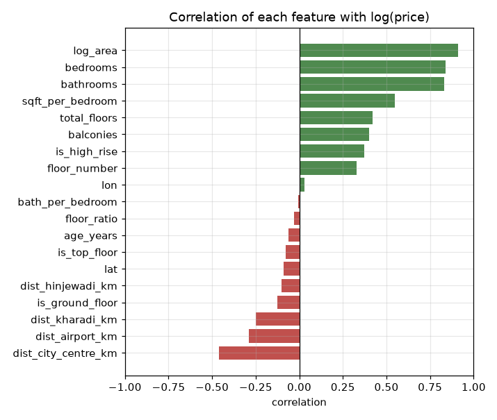

# Step 4: features

63,687 rows · 21 features · 378 locality groups (2,633 rows in 'Other') · location known for 98.4% of rows

| Feature | Correlation with log(price) | Filled % |
|---|---|---|
| log_area | +0.910 | 100.0 |
| bedrooms | +0.839 | 100.0 |
| bathrooms | +0.829 | 99.9 |
| sqft_per_bedroom | +0.546 | 100.0 |
| dist_city_centre_km | -0.459 | 98.4 |
| total_floors | +0.422 | 68.5 |
| balconies | +0.402 | 66.8 |
| is_high_rise | +0.371 | 68.5 |
| floor_number | +0.328 | 66.5 |
| dist_airport_km | -0.291 | 98.4 |
| dist_kharadi_km | -0.249 | 98.4 |
| is_ground_floor | -0.124 | 66.5 |
| dist_hinjewadi_km | -0.104 | 98.4 |
| lat | -0.091 | 98.4 |
| is_top_floor | -0.077 | 66.5 |
| age_years | -0.061 | 59.2 |
| floor_ratio | -0.029 | 66.5 |
| lon | +0.029 | 98.4 |
| bath_per_bedroom | -0.005 | 99.9 |

Categorical: locality_group, property_type (encoded inside the model pipeline in step 6).

