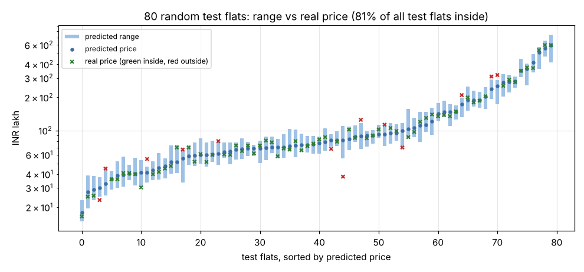
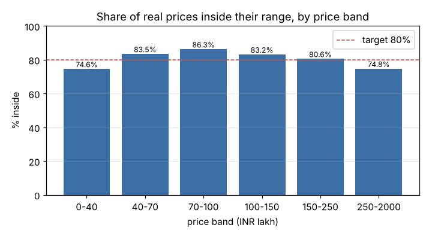
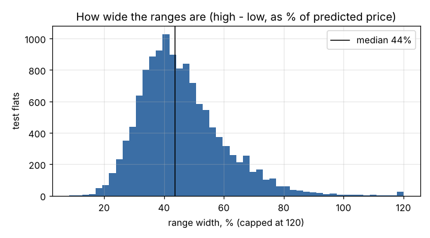

# Step 10: price range

Target: 80% of real prices inside the range. Calibrated with cross-validation on 50,787 training flats, checked once on 12,697 test flats.

| | |
|---|---|
| Inside the range before calibration (cross-validation) | 66.6% |
| Calibration: range widened on each side by | +5.1% |
| **Inside the range on unseen test flats** | **81.5%** |
| Typical range | 19% below to 24% above the predicted price (median width 44%) |

## Examples (typical 1, 2 and 3 BHK test flats)
| # | locality | bedrooms | price_lakh | low_lakh | predicted_lakh | high_lakh | inside |
|---|---|---|---|---|---|---|---|
| 0 | Pisoli | 1.0 | 35.0 | 29.6 | 33.8 | 43.7 | True |
| 1 | Mahalunge | 2.0 | 71.0 | 62.8 | 70.5 | 94.2 | True |
| 2 | Wagholi | 3.0 | 135.0 | 90.5 | 132.8 | 156.6 | True |

## By price band
| price_band | test_flats | inside_pct | median_width_pct |
|---|---|---|---|
| 0-40 | 1988 | 74.6 | 46.9 |
| 40-70 | 3156 | 83.5 | 43.5 |
| 70-100 | 2789 | 86.3 | 41.8 |
| 100-150 | 2030 | 83.2 | 44.650000000000006 |
| 150-250 | 1443 | 80.6 | 45.0 |
| 250-2000 | 1291 | 74.8 | 42.1 |

## Narrowest ranges (localities with 50+ test flats)
| locality_group | test_flats | inside_pct | median_width_pct |
|---|---|---|---|
| Kiwale | 74 | 71.6 | 27.700000000000003 |
| Tathawade Pimpri Chinchwad | 105 | 84.8 | 30.9 |
| Amanora Park Town | 72 | 87.5 | 33.05 |
| Dhanori | 145 | 86.2 | 34.3 |
| Pashan | 72 | 68.1 | 35.0 |

## Widest ranges
| locality_group | test_flats | inside_pct | median_width_pct |
|---|---|---|---|
| Narhe | 83 | 81.9 | 56.0 |
| Koregaon Park | 343 | 85.7 | 58.4 |
| Other | 510 | 77.6 | 59.55 |
| Kalyani Nagar | 430 | 85.1 | 59.75 |
| Hadapsar | 451 | 82.0 | 63.8 |

Ranges are wider where prices vary more for similar flats (e.g. large mixed areas), and narrower in localities with many similar listings.

