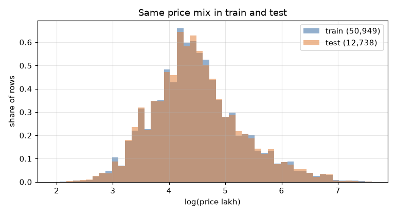

# Step 5: train/test split

Settings: {'test_size': 0.2, 'random_state': 42, 'price_bins': 10}

| | Train | Test |
|---|---|---|
| rows | 50,949 | 12,738 |
| median_price_lakh | 82.0 | 82.0 |
| mean_price_lakh | 127.1 | 126.1 |
| median_area_sqft | 1,108 | 1,107 |
| 1 BHK % | 17.8 | 17.3 |
| 2 BHK % | 44.2 | 44.3 |
| 3 BHK % | 28.2 | 28.5 |
| 4 BHK % | 8.5 | 8.7 |
| with_floor_info % | 66.4 | 66.8 |

Locality groups in test but not in train: none

